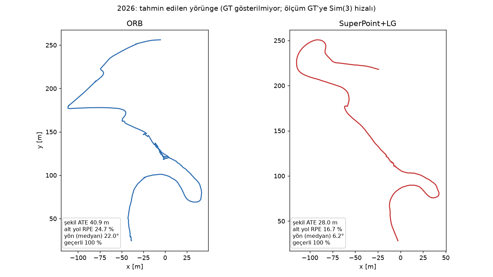

# Monocular Visual Odometry for GNSS-Denied Drones: A Scale Study

Estimating a drone's trajectory from a single camera, without GPS, IMU or other sensors, and measuring how far that can go. The trajectory **shape** can be recovered well; **metric scale** could not be solved from a single camera alone, and this repo documents the experiments behind that conclusion.



**Key result:** replacing ORB with **SuperPoint + LightGlue** reduced shape error (Sim(3)-aligned ATE) by **31–39%** across three flights, under the same tuning budget.

The project is closed. Full write-up (Turkish): [KAPANIS_RAPORU.md](KAPANIS_RAPORU.md). The follow-up work, visual-inertial odometry with an IMU (where scale becomes observable), continues in a separate repository.

## Method

1. **Features and matching:** SuperPoint + LightGlue (baseline: ORB + brute-force matching).
2. **Pose estimation:** essential matrix (E-only; homography path disabled).
3. **Accumulation:** unit-length translations and rotations are chained into a trajectory.
4. **Scale:** metric scale could not be recovered without additional sensors; it is reported separately.

## Results (selected settings)

| flight | front end | shape ATE (m) | sub-path RPE (%) | position RMSE (m) |
|---|---|---|---|---|
| 2026 | ORB | 40.9 | 24.7 | 67.7 |
| 2026 | SuperPoint+LG | **28.0** | **16.7** | 113.1 |
| session_3 | ORB | 21.0 | 11.8 | 41.2 |
| session_3 | SuperPoint+LG | **14.0** | **8.3** | 41.3 |
| 2024 (XY only) | ORB | 72.1 | 19.4 | 153.2 |
| 2024 (XY only) | SuperPoint+LG | **44.1** | **13.3** | 119.2 |

Notes:
- Both front ends were tuned with the same budget (6 configurations each), selected on the 2026 and session_3 flights only. The 2024 flight is a held-out check.
- The 2024 data has no ground-truth altitude, so only XY metrics are reported and it is not compared in absolute terms with the other flights.
- Position RMSE is large because of the unsolved scale; the shape metric is not affected by it.

### Metrics

- **Shape ATE (m):** the full trajectory is aligned to ground truth with Sim(3); remaining 3D RMS error. This is an idealized metric because the alignment uses ground truth.
- **Sub-path RPE (%):** KITTI-style relative translation error over 100–800 m sub-paths.
- **Position RMSE (m):** real position error at production scale, with alignment on the first 450 frames only.
- **Heading error (°):** median difference between estimated and ground-truth velocity direction.

## What was learned

- Metric scale was not solved from a single camera. Tested and documented: parallax, ground-truth altitude, semantic (object-size) altitude, heading measurement, and bundle adjustment. None changed the conclusion.
- Rotation error of about 0.5° per step accumulates and distorts the shape; most of the heading error comes from rotation.
- Loop closure and full BA were not applied to the final pipeline, which limits the results.
- Real-time performance was not measured; results were produced from recorded step outputs.
- The 2026 production config uses ground-truth altitude, so absolute numbers may be optimistic. The two front ends were compared under the same conditions, so the relative result holds.

## Setup

```bash
pip install -r requirements.txt
python main.py --config config_final_sp_eonly.yaml
```

Options: `--max-frames N`, `--no-viz`, `--output-dir DIR`. Data paths, camera parameters and evaluation settings are defined in the config file. Data is not included in this repo.

## Tests

```bash
pip install numpy pyyaml opencv-python-headless pytest
pytest -q
```

Tests check the numerical core (Sim(3) alignment, pose accumulation, LightGlue safety lock) without any data. CI runs them on every push.

## Evaluation

All reported numbers come from one canonical script:

```bash
python experiments/evaluate_canonical.py
```

It writes `results/canonical_table.md` and `results/canonical_table.csv`, and expects step logs (`grid_*.pkl`) and ground-truth files under `data/`, which are not in this repo.

## Repository layout

- `core/`: pipeline modules (features, matching, pose, scale, pose graph)
- `utils/`: data loader, camera calibration
- `experiments/`: canonical evaluation, figures, EuRoC comparison script (`euroc_pipeline.py`)
- `results/`: result tables and figures without ground truth (`figures_nogt/`, `figures/`)
- `config.yaml`: production config (ORB); `config_final_sp_eonly.yaml`: SuperPoint+LG, E-only
- `main.py`: entry point

## Data note

The flight data comes from the TEKNOFEST competition and is not redistributed. Figures with ground-truth overlays are not published until the data terms are clear. Early commits in the history may contain competition data files; they are not tracked in the current tree.

## License

Code is released under the [MIT license](LICENSE). Datasets are subject to their own licenses.
